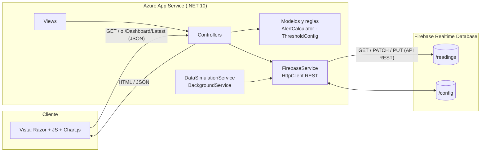

# MeteoGuard · Estación Meteorológica IoT

Solución web **MVC** (ASP.NET Core .NET 10) para la temática **N.º 7 — Monitoreo meteorológico IoT**:
dashboard de temperatura y humedad en vivo con datos simulados, estados de alerta configurables,
historial y gráficos. Persiste en **Firebase Realtime Database** y se despliega en **Azure App Service**.

> **Demo estática (GitHub Pages)**: <https://hugoamedinao27-beep.github.io/Estacion_metereologica/>
> R\u00E9plica est\u00E1tica de la interfaz para demostraci\u00F3n r\u00E1pida: incluye **dashboard IoT simulado**, **historial y gr\u00E1ficos**, **configuraci\u00F3n de umbrales** y **Clima por ciudad** (consulta tiempo actual y pron\u00F3stico 5 d\u00EDas con Open-Meteo). la simulación corre en el navegador y la
> persistencia usa `localStorage` (o Firebase si se configura `FIREBASE_URL` en `demo/demo.js`).
> La aplicación MVC completa — entregable oficial — se despliega en Azure App Service.


## Funcionalidades (MVP)

| # | Funcionalidad | Dónde |
|---|---|---|
| 1 | Dashboard en vivo (tarjeta de estado + gráfico, actualiza cada 5 s) | `Dashboard` + `wwwroot/js/dashboard.js` |
| 2 | Máquina de estados de alerta: Frío / Normal / Precaución / Calor / Crítico | `Services/AlertCalculator.cs` |
| 3 | Configuración de umbrales con validaciones server-side y mensajes | `SettingsController` + `Views/Settings/Index.cshtml` |
| 4 | Historial y gráficos de las últimas lecturas | `History` + `wwwroot/js/history.js` |

## Requisitos

- .NET SDK 10.0 o superior (`dotnet --version`)
- (Para datos en vivo) un proyecto Firebase con Realtime Database — ver [docs/despliegue-azure-y-firebase.md](docs/despliegue-azure-y-firebase.md)

## Ejecutar en local

```bash
dotnet run
```

La app queda en `http://localhost:5000` / `https://localhost:5001` (ver `Properties/launchSettings.json`).
**Sin Firebase configurado la app funciona igual**: el dashboard muestra un aviso y los datos quedan vacíos.
Para conectar Firebase, complete en `appsettings.json`:

```json
"Firebase": {
  "DatabaseUrl": "https://TU-PROYECTO-default-rtdb.firebaseio.com"
}
```

> Nunca suba esta URL con credenciales al repositorio si decides protegerla: en Azure se configura
> como variable de entorno `Firebase__DatabaseUrl` en *Application Settings*.

## Arquitectura (MVC + servicios cloud)



### Recorrido de una solicitud (dashboard)

1. El navegador hace `fetch("/Dashboard/Latest")` cada 5 segundos (`dashboard.js`).
2. El enrutador MVC entrega la solicitud a `DashboardController.Latest()`.
3. El controlador llama a `FirebaseService.GetLatestReadingAsync()` y `GetConfigAsync()`.
4. `FirebaseService` consulta la API REST de Firebase (`GET /readings.json?orderBy="$key"&limitToLast=1`).
5. El controlador devuelve JSON (camelCase); la vista/JS actualiza la tarjeta y el gráfico.

### Estructura del código

```
Controllers/   Home · Dashboard · History · Settings
Models/        Reading · AlertState · ThresholdConfig (+ ViewModels)
Services/      AlertCalculator · FirebaseService · DataSimulationService
Views/         Razor (diseño responsivo heredado de la landing original)
wwwroot/       css/styles.css · js/dashboard.js · js/history.js · js/site.js
referencia-estatica/   HTML/CSS/JS original (estático) como referencia
```

## Servicios cloud utilizados

| Servicio | Función en la solución |
|---|---|
| **Azure App Service** | Ejecuta y publica la aplicación ASP.NET Core; entrega la URL accesible. La variable `Firebase__DatabaseUrl` se configura en Application Settings. |
| **Firebase Realtime Database** (Google) | Persistencia de lecturas (`/readings`) y umbrales (`/config`) vía API REST; base del dashboard en vivo. |

Plan de Firebase: **Spark (gratuito)**. App Service: plan **Free/Basic** o *Azure for Students*.

## Roles del equipo

| Integrante | Responsabilidad |
|---|---|
| 1 — Interfaz y UX | Vistas Razor, `styles.css`, `dashboard.js` / `history.js`, mensajes al usuario |
| 2 — Arquitectura y lógica | Controllers, `AlertCalculator`, flujo de solicitudes, diagrama |
| 3 — Datos e integración | `FirebaseService`, `DataSimulationService`, `ThresholdConfig`, estructura RTDB |
| 4 — Despliegue y operación | Proyecto Firebase, App Service, publicación, Application Settings, documentación Azure |

## Documentación

- [Justificación de la arquitectura](docs/justificacion-arquitectura.md)
- [Guía de Firebase y despliegue en Azure](docs/despliegue-azure-y-firebase.md)
